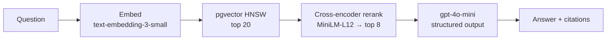

# RAGBench — A Measured RAG Pipeline

[](https://github.com/ParthParmar88/RAGBench---A-Measured-RAG-Pipeline/actions/workflows/tests.yml)

A retrieval-augmented question-answering system over PDFs. It started as a basic RAG
pipeline and was improved one version at a time, with each change measured against a
fixed benchmark before it was kept.

**FastAPI · PostgreSQL + pgvector · OpenAI · sentence-transformers · RAGAS · React**

## Evolution

Reranking raised the share of questions that find the right passage from **80% to 92%**
on the benchmark it was tuned on, and from **74% to 79%** on a held-out set of unseen
questions, at 1.5× the baseline's LLM tokens. The held-out check is the more honest
number: the direction held, and the size roughly halved.

<picture>
  <source media="(prefers-color-scheme: dark)" srcset="docs/images/evolution-dark.svg">
  
</picture>

The chart shows the tuning benchmark. There were two ways to improve on the baseline.
Sending the model more chunks (orange) works, but token cost grows almost as fast as
quality. Reranking (blue) gets a large part of the gain for a fraction of the tokens.

| Version | What changed | Why | Measured result |
|---|---|---|---|
| **v1.0** Baseline | Embed → pgvector top-5 → one `gpt-4o-mini` call | Starting point | Nothing measurable yet: no tests, no benchmark |
| **v1.0.1** Safety net | Removed dead code, added a test harness | Make later changes safe | 28 tests, behaviour unchanged |
| **v1.1** Instrumentation | Per-stage latency, per-call token and cost tracking, idempotent ingestion, page provenance | You can't improve what you don't measure | 63 tests |
| **v1.2** Benchmark | 75 questions over 8 papers, ground truth tied to verbatim quotes; baseline run twice | A fixed yardstick, and a measure of the LLM judge's noise | Baseline **80.3%** hit rate. The judge varies ±0.10 on faithfulness, so decisions use exact metrics. |
| v1.2 · exp-002 | Sweep of chunks sent to the LLM: 5 → 10 → 20 | Is retrieval depth the bottleneck? | 93.4% at top-20, but **3.6× tokens**, and correct refusals fell from 5/8 to 4/8. Not shipped. |
| **v1.3** Reranking | Fetch 20, a local cross-encoder keeps the best 8 | Keep the recall gain without the token cost | **91.8%** hit rate, context recall 0.84 → **0.91**, 1.5× baseline tokens. Adds ~4 s CPU latency. |
| **v1.3** Relevance gate | Answer "not found" without calling the LLM when the best rerank score is below −2.5 | Stop confident answers to questions the documents can't answer | Unanswerable refused 5/8 → 6/8. Within noise, so reported as inconclusive. |
| **v1.4** Held-out check | 46 new questions from unused passages, generated after every setting was fixed | Were the gains real, or fitted to the benchmark? | Reranking: **73.5% → 79.4%**, about half the tuned gain. The gate refused 3 of 34 answerable questions and caught nothing new, so it was **turned off**. |
| **v1.4** Benchmark fix | A blank ground-truth quote was matching every passage | Found while building the held-out set | Baseline corrected from 82.0% to 80.3%. All experiments rescored from stored contexts, with no re-runs. |

**Not built, on purpose:** hybrid keyword search. On the tuning benchmark the baseline
already answered 13 of 14 keyword questions, so there was almost nothing for it to fix.

Full analysis, including the judge-noise measurement, why the gate failed, and each
experiment's caveats, is in **[RESULTS.md](RESULTS.md)**. The chart is generated from the stored results by
[`scripts/plot_evolution.py`](scripts/plot_evolution.py).


## Pipeline



Every query makes **one embedding call and one chat call**. Reranking runs locally, so
it adds latency but no API cost. Each stage is timed separately, and every LLM call's
tokens and cost are recorded in Postgres. An optional relevance gate
(`MIN_RERANK_SCORE`) can skip the chat call when nothing retrieved scores as relevant. It
is off by default because it did not hold up on held-out questions.

Ingestion: PDF → per-page text (`pypdf`) → 1200-character chunks with 150 overlap →
page-number resolution → batch embeddings → pgvector. Ingestion is idempotent, keyed on
the file's SHA-256.

## Evaluation

[`backend/evaluation/`](backend/evaluation/) contains the benchmark and the tools that run it:

- **Corpus.** 8 arXiv IR/NLP papers (BERT, DPR, ColBERT, RAG, BEIR, …), 445 chunks,
  pinned by SHA-256.
- **Dataset.** 75 questions in 7 categories: factual, semantic, keyword, multi-chunk,
  multi-document, ambiguous, and unanswerable. Ground truth is tied to **verbatim quotes**
  rather than chunk ids, so results stay comparable when chunking changes. 26% of
  generated candidates failed that check and were rejected.
- **Held-out set.** 46 more questions, generated after all settings were fixed and only
  from passages the main dataset never used. It is for confirming a finished
  configuration, never for tuning.
- **Metrics.** Two kinds:
  - Deterministic retrieval metrics (quote hit rate and recall), which are exact and
    identical on every run.
  - RAGAS (faithfulness, relevancy, context precision and recall), graded by a pinned
    `gpt-4o-mini` judge.
- **Runner and comparison.** Results are written to immutable per-experiment directories,
  and `compare` reports deltas plus which questions flipped between two runs.
- **Rescoring.** Every run stores its retrieved contexts, so when the scorer or a
  ground-truth entry is corrected, `rescore` recomputes retrieval metrics exactly without
  re-running anything.

See [backend/evaluation/README.md](backend/evaluation/README.md) for how the dataset
was built and its known limitations.

## Run it

**Prerequisites:** Python 3.11+ (developed on 3.14), Node 18+, and PostgreSQL 14+ with the
[pgvector](https://github.com/pgvector/pgvector) extension. Create an empty database with
`CREATE DATABASE ragbench;`. Tables, the `vector` extension and indexes are created on startup.

```bash
# Backend
cd backend
python -m venv .venv
.venv\Scripts\activate            # macOS/Linux: source .venv/bin/activate
pip install -r requirements.txt
copy .env.example .env            # macOS/Linux: cp; then set OPENAI_API_KEY
uvicorn app.main:app --reload     # http://localhost:8000/docs

# Frontend (second terminal)
cd frontend
npm install
npm run dev                       # http://localhost:5173
```

```bash
# Tests (offline, no API key needed)
pip install -r requirements-dev.txt
python -m pytest

# Evaluation: fetch and ingest the corpus once, then run experiments
pip install -r requirements-eval.txt
python -m evaluation.fetch_corpus
python -m evaluation.ingest_corpus
python -m evaluation.run_experiment --id my-run --rerank --top-k 8
python -m evaluation.compare exp-001-baseline my-run
```

## Configuration (`backend/.env`)

| Variable | Default | |
|---|---|---|
| `OPENAI_API_KEY` | — | required |
| `OPENAI_MODEL` | `gpt-4o-mini` | answer generation |
| `OPENAI_EMBEDDING_MODEL` | `text-embedding-3-small` | 1536 dims |
| `TOP_K` | `5` | chunks the LLM sees (recommended: `8` with reranking) |
| `RERANK_ENABLED` | `false` | cross-encoder reranking |
| `RERANK_MODEL` | `cross-encoder/ms-marco-MiniLM-L12-v2` | |
| `RERANK_CANDIDATES` | `20` | vector candidates fetched before reranking |
| `MIN_RERANK_SCORE` | unset | optional relevance gate; leave unset (see RESULTS.md) |
| `CHUNK_SIZE` / `CHUNK_OVERLAP` | `1200` / `150` | characters |
| `PG_HOST`, `PG_PORT`, `PG_DATABASE`, `PG_CONNECTION_USER`, `PG_CONNECTION_PASSWORD` | `localhost`, `5432`, `ragbench`, `postgres`, `root` | |

The code defaults reproduce the original baseline exactly. `.env.example` ships the
recommended configuration (reranking on, k=8).

## Project layout

```
backend/
  app/
    api/routes/        chat, documents (upload/list/delete), usage (cost reporting)
    services/
      rag.py           query path: embed → search → rerank → synthesize, timed per stage
      reranker.py      cross-encoder reranking
      synthesizer.py   grounded structured-output generation with citations
      ingestion.py     idempotent PDF ingest with page provenance
      llm.py, usage.py, pricing.py   token and cost capture on every LLM call
  evaluation/          corpus, dataset, metrics, experiment runner, results/
  tests/               117 offline tests, run on every push
frontend/              React + Vite + Tailwind
scripts/               plot_evolution.py (README chart from results), snapshot.py
docs/architecture.md   design decisions and known limitations
RESULTS.md             experiment results and analysis
```
