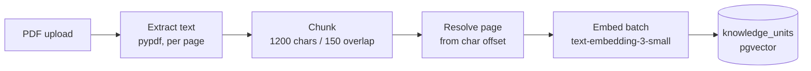

# Architecture

How paraX is built, what the baseline does, and where its limits are.

This document is written *before* the optimization experiments so the starting
point can't be retroactively flattered. Sections marked **Known limitation**
are the things the experiments exist to test.

---

## 1. The baseline (V1)

A linear Retrieval-Augmented Generation pipeline: one retrieval step, one
generation step, no branching.


Exactly **two API calls per query**: one embedding, one chat completion.
Retrieval itself is pure SQL — no LLM involved.

### Ingestion



### Stack

| Layer | Choice |
|---|---|
| Runtime | Python 3.14 |
| API | FastAPI + uvicorn |
| Store | PostgreSQL 18 + pgvector (HNSW, cosine) |
| Embeddings | OpenAI `text-embedding-3-small`, 1536d |
| Generation | OpenAI `gpt-4o-mini`, structured output |
| Frontend | React 18 + Vite + Tailwind |
| Tests | pytest |

---

## 2. Data model

```
documents                    knowledge_units
---------                    ---------------
id            <-------+      id
title (unique)        +----- document_id (FK, cascade)
content_sha256               title
page_count                   content
chunk_count                  page          -- 1-based, from the source PDF
created_at                   chunk_index   -- 0-based, ordinal within document
updated_at                   embedding     -- vector(1536)

model_pricing                llm_usage
-------------                ---------
id            <-------+      id, created_at, request_id
provider, model       +----- pricing_id (FK)
input_per_1m                 provider, model_requested, model, operation
output_per_1m                input_tokens, output_tokens, total_tokens
cached_input_per_1m          cached_tokens
currency                     input_cost, output_cost, total_cost, currency
effective_from               latency_ms, raw_usage
effective_to
```

**Why `documents` exists.** Evaluating retrieval means asking "did it find the
*right* passage?", which requires a stable way to name passages. A filename
string can't do that. `content_sha256` additionally makes ingestion idempotent.

**Why `model_pricing` is time-versioned.** Cost is computed at write time and
frozen on the usage row. Re-pricing a model later doesn't silently rewrite the
cost of experiments already run — a past experiment's cost stays what it
actually was.

---

## 3. Measurement

Every LLM call passes through one choke point (`services/llm.py`), which
records tokens and latency into a request-scoped `UsageContext`.
`services/usage.py` prices each call and persists it.

Per-query latency is broken out by stage:

| Metric | Covers |
|---|---|
| `embedding_ms` | the query embedding API call |
| `search_ms` | the pgvector ANN scan |
| `retrieval_ms` | `embedding_ms + search_ms` |
| `generation_ms` | the chat completion call |
| `total_ms` | whole query, excluding usage persistence |

`retrieval_stats` summarizes retrieval quality from similarity scores alone
(`chunk_count`, `top_score`, `avg_score`). This is deliberately cheap and is
for triage, not for grading: a bad answer with `top_score = 0.31` is a
retrieval failure; the same answer with `top_score = 0.89` is a generation
failure. Those need different fixes.

---

## 4. Module layout

```
backend/app/
├── api/routes/
│   ├── documents.py     upload / list / delete
│   ├── chat.py          thin: delegates to services/rag.py
│   └── usage.py         cost reporting
├── services/
│   ├── pdf_extractor.py PDF -> text + page spans
│   ├── chunker.py       text -> chunks + offsets
│   ├── ingestion.py     orchestrates ingest, enforces idempotency
│   ├── embeddings.py    OpenAI embeddings
│   ├── vector_store.py  storage + similarity search
│   ├── synthesizer.py   context assembly + grounded generation
│   ├── rag.py           the query path, instrumented
│   ├── llm.py           the single usage-capture choke point
│   ├── pricing.py       rate resolution + cost arithmetic
│   └── usage.py         persistence + turn summary
├── core/prompts.py
├── models.py            ORM
├── schemas.py           HTTP contracts
├── config.py            env-driven settings
└── database.py          engine, session, schema bootstrap
```

`services/rag.py` returns a richer result than the HTTP API exposes — notably
**all retrieved contexts**, not just the ones the model cited. Evaluation calls
it directly rather than over HTTP, which is why the chat response can stay lean.

---

## 5. Known limitations

These are the baseline's real weaknesses. Each maps to a planned experiment.

### 5.1 Chunking is structure-blind — **the dominant limitation**

`chunk_text` slides a fixed 1200-character window with 150 characters of
overlap. It has no notion of sentences, paragraphs, or headings, so it splits
mid-sentence and mid-word.

This caps everything downstream. **Hybrid retrieval and reranking cannot repair
a fact severed across two chunks** — no retriever can find a whole passage that
was never stored whole. Any experiment run before this is addressed risks
measuring the chunker rather than the retriever.

→ *Experiment 002*

### 5.2 No lexical retrieval

Retrieval is purely semantic. Embeddings blur exact tokens, so a query for a
specific identifier (`ColBERT`, `Depends()`, an error code) can rank a
topically-similar-but-wrong passage above the exact match.

→ *Experiment 003 (hybrid retrieval)*

### 5.3 Retrieval count and generation count are the same number

`TOP_K = 5` serves as both "how many chunks to fetch" and "how many the LLM
sees". Reranking requires decoupling these — fetch ~20 for recall, rerank down
to ~5 for precision.

→ *Experiment 004*

### 5.4 Citations are self-reported

The model returns `source_numbers`, and only those chunks appear in `sources`.
A chunk can inform the answer without being cited, and a citation can be
spurious. **Retrieval metrics must never be computed from `sources`** — use
`QueryResult.contexts`, which is the full retrieved set.

### 5.5 `chunk_overlap=0` is silently ignored

```python
overlap = chunk_overlap or settings.CHUNK_OVERLAP   # 0 or 150 -> 150
```

`0` is falsy, so an explicit zero becomes the configured default. No caller
passes 0 today, so baseline results are unaffected — but "no overlap" is
unreachable through the API, and it's a control condition Experiment 002 wants.
Pinned by `test_zero_overlap_is_silently_ignored`; fix with `is None` in 002.

### 5.6 Schema migrations are hand-rolled

`database.py` runs idempotent DDL at startup instead of using Alembic. With
four tables and one developer, a migration toolchain costs more than it
returns. That trade-off flips if the schema grows or a second environment
appears — adopt Alembic then.

### 5.7 pypdf was upgraded before any measurement

Extraction originally ran on pypdf 5.1.0, which raised `UnboundLocalError` on a
malformed Type1 font table in `colbert.pdf` and aborted the whole document.
Upgraded to 6.16.0, and `extract_pages` now isolates failures per page: a bad
page is logged and treated as empty rather than losing the paper.

Done deliberately *before* any baseline number existed, since text extraction
changes chunk boundaries. Doing it later would have invalidated every prior
result.

### 5.8 No retrieval filtering

Search returns the top *k* regardless of score. A query with no relevant
content still returns 5 chunks, at whatever similarity. The synthesizer prompt
is the only guard against answering from irrelevant context.

---

## 6. Reproducibility

Version control is unavailable on the development machine, so phase boundaries
are frozen as immutable archives instead:

```bash
python scripts/snapshot.py <name> --note "what this is"
```

Each writes `snapshots/<name>.zip` plus a manifest with a SHA-256. The script
refuses to overwrite an existing snapshot: a phase boundary happens once, and
overwriting one would silently invalidate every experiment citing it. Secrets,
virtualenvs, and dependencies are excluded; restoring is a plain unzip.

| Snapshot | Contents |
|---|---|
| `v1.0-baseline-rag` | the RAG exactly as found |
| `v1.0.1-baseline-phase0` | + dead code removed, + 28 tests. Behaviour identical. |
| `v1.1-phase1-measured` | + idempotent ingestion, chunk provenance, latency breakdown |
| `v1.2-phase2-benchmark` | + evaluation corpus (8 papers, 445 chunks) and 75-case benchmark |

The stronger guarantee is behavioural rather than archival: from Experiment 003
onward, the advanced codebase reproduces baseline behaviour by configuration
(`RETRIEVAL_MODE=vector`, `RERANKING_ENABLED=false`, …). Being able to *re-run*
the baseline matters more than being able to *read* it.

---

## 7. Running it

```bash
# backend
cd backend
.venv\Scripts\activate
pip install -r requirements.txt -r requirements-dev.txt
uvicorn app.main:app --reload      # schema + migrations run on startup

# tests
python -m pytest

# frontend
cd frontend && npm install && npm run dev
```

Configuration is environment-driven via `backend/.env` (see `.env.example`).
`.env` is gitignored and excluded from snapshots; it holds the OpenAI key.
